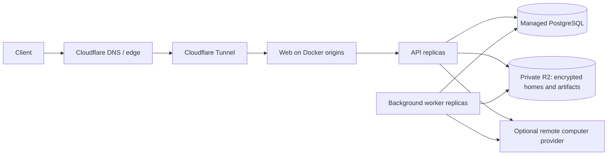

# Cloudflare deployment

Terraform provisions private R2 storage, a Cloudflare Tunnel, and the public DNS record.
API, background worker and web run in Docker on ordinary Linux hosts. The optional `compute/`
Terraform root provisions x86 Hetzner hosts; existing Docker hosts work with the same deploy
scripts. PostgreSQL is a separately provisioned, managed service in the origin's region.

This profile favors predictable compute costs for continuously running agents and database
listeners. It does **not** convert Rakazo to Cloudflare Workers, provision PostgreSQL inside
Cloudflare, or add a new computer provider. D1 is SQLite. Hyperdrive is a database proxy and
does not support the advisory locks and `LISTEN/NOTIFY` used by this application. Consequently,
all database traffic here uses a direct PostgreSQL endpoint with verified TLS.



No script automatically runs `terraform apply`, buys a service, or deploys when sourced.
`deploy.mjs prepare` writes local files only; `deploy.mjs apply` changes the selected origins.

## Prerequisites

- Terraform 1.13+, Node 22+, Docker/buildx, OpenSSH, rsync and a registry you can publish to.
- A Cloudflare account with R2 enabled and the application domain's zone already onboarded.
- An API token with R2 bucket configuration, Tunnel configuration/token read, and DNS write
  permissions scoped to this account/zone. Set `CLOUDFLARE_API_TOKEN` in the operator environment.
- A managed PostgreSQL database with direct TLS connectivity, backups/PITR configured, a migration
  owner and a separate runtime login. The migration command creates/grants the runtime role when
  allowed; otherwise provision its role membership in advance as described in
  [database roles](../../docs/self-host-configuration.md#database-roles).
- On every origin: Linux amd64, Docker Engine, rsync, Compose **2.30+**, root SSH access restricted to
  administrator/CI addresses, outbound Internet access, sufficient disk for images and home staging.
  Cloud-init in the optional compute root installs Docker from its official signed apt repository.

The app and migration URLs must name the same database endpoint with distinct logins and
`sslmode=verify-full`. Do not use Hyperdrive, a transaction pooler, or a pooled Neon URL for the
Graphile queue. Set an appropriate database connection limit: each origin has an API pool and
a worker pool, plus dedicated realtime connections and deployment/migration headroom. Persistent
listeners can prevent a serverless database from sleeping; do not budget on scale-to-zero savings.

## 1. Provision Cloudflare

From the repository root:

```sh
cp infra/cloudflare/terraform/terraform.tfvars.example infra/cloudflare/terraform/production.tfvars
# Edit the account, zone, hostname and deployment name. No secrets belong in tfvars.
terraform -chdir=infra/cloudflare/terraform init
terraform -chdir=infra/cloudflare/terraform plan -var-file=production.tfvars -out=production.tfplan
# Review the saved plan, then explicitly apply it:
terraform -chdir=infra/cloudflare/terraform apply production.tfplan
mkdir -p infra/cloudflare/.runtime
terraform -chdir=infra/cloudflare/terraform output -json deployment > infra/cloudflare/.runtime/foundation.json
```

Both buckets have public `r2.dev` access disabled and deletion protection in Terraform. There
are no public bucket custom domains. The only lifecycle rule aborts unfinished multipart uploads
after one day; live homes and completed backups never expire automatically. The R2 location is a
placement hint, not a residency guarantee. For a contractual jurisdiction requirement, adapt and
review the bucket configuration before creating data.

Create a separate R2 S3 credential scoped to read/write/list/delete **only the data bucket**.
Its access key and secret go into the application secret file below. The application never gets
backup-bucket credentials. R2 object versioning must not be assumed; use coordinated snapshots
below and retain the database and encryption keys together.

Terraform states and plans remain outside git and Docker builds. For team/CI use, configure a
locking remote backend (for example HCP Terraform) for each root before the first apply, or use
`terraform init -migrate-state` when moving an existing state. Do not run independent local
states against the same resources. Application/database/R2 credentials are not Terraform inputs.

## 2. Provision or select Docker origins

To use the optional Hetzner module, set `HCLOUD_TOKEN` in the operator environment, then:

```sh
cp infra/cloudflare/compute/terraform.tfvars.example infra/cloudflare/compute/production.tfvars
# Set an existing SSH key and your actual administrator/CI IP CIDRs.
terraform -chdir=infra/cloudflare/compute init
terraform -chdir=infra/cloudflare/compute plan -var-file=production.tfvars -out=production.tfplan
terraform -chdir=infra/cloudflare/compute apply production.tfplan
terraform -chdir=infra/cloudflare/compute output -json hosts > infra/cloudflare/.runtime/hosts.json
```

The default is one 8-GB-class x86 origin, with host backups and deletion/rebuild protection.
One origin has downtime during rollout. Two or more keep another connector available, but
existing SSE/WebSocket streams may reconnect. Tunnel replicas provide failover; they are not a
load-driven autoscaler or a guarantee of even traffic distribution. Observe utilization and
distribution before adding replicas; add explicit load-balancing infrastructure when required.

For existing hosts, write a JSON array such as `["root@192.0.2.10", "root@192.0.2.11"]` to the
same inventory file. Verify SSH host keys against the provider console or another trusted
channel and install them in `known_hosts`. The scripts deliberately require strict host-key
checking. Wait for `cloud-init status --wait` on new hosts and verify `docker compose version`.
No HTTP, database, or Docker daemon ports are published by this profile.

## 3. Build the fork and configure it

Build **this fork**, not an upstream image missing its credit migrations:

```sh
bash infra/cloudflare/scripts/build-image.sh registry.example.com/your-team/rakazo:release-1 --push
docker buildx imagetools inspect registry.example.com/your-team/rakazo:release-1
docker buildx imagetools inspect docker.io/cloudflare/cloudflared:2026.10.2
```

Select a reviewed official cloudflared release available in your registry; the tag above is an
example. Record each registry manifest digest. Deployment accepts only `repository@sha256:...`.
Authenticate each origin to a private application registry with a read-only pull credential
before deployment. Registry credentials are intentionally not copied from the operator machine.

```sh
cp infra/cloudflare/runtime.example.json infra/cloudflare/runtime.local.json
cp infra/cloudflare/secrets.example.json infra/cloudflare/secrets.local.json
chmod 600 infra/cloudflare/*.local.json
```

Replace every placeholder. Generate and retain independent random values of at least 32
characters for `ENCRYPTION_KEY`, `BETTER_AUTH_SECRET` and `SCREEN_PROXY_SECRET`. Never regenerate
the encryption key during rollout. Back it and any `ENCRYPTION_MASTER_KEYS` up separately.
No script prints these values. Environment files use Compose's raw format, preserving `$`,
quotes and backslashes. JSON configuration must use string values without embedded newlines.

`SANDBOX_PROVIDER=none` starts without paid computers. To offer computers, select an existing
remote provider and add its documented credentials/template configuration; see
[sandbox configuration](../../docs/self-host-configuration.md#core-settings). The provider bills
for active compute; R2 only stores encrypted homes and artifacts. No Docker-in-Docker socket is
exposed. Personal desktop-computer connections are disabled in this multi-host profile because
their peer forwarding needs routable per-instance internal addresses; do not enable them until
that networking is configured and verified.

Signups default to disabled. Configure an email provider and initially allow only operator
addresses before opening registration. Credit administration requires a verified email listed
in `RAKAZO_ADMIN_EMAILS`. Configure the server's managed model using existing `PI_DEFAULT_*`
settings and its supported provider credential. The sample's model ID is deliberately not a
vendor/model recommendation.

## 4. Prepare, review and deploy

```sh
node infra/cloudflare/scripts/deploy.mjs prepare \
  infra/cloudflare/.runtime/foundation.json infra/cloudflare/.runtime/hosts.json \
  infra/cloudflare/runtime.local.json infra/cloudflare/secrets.local.json \
  registry.example.com/your-team/rakazo@sha256:YOUR_IMAGE_MANIFEST_DIGEST \
  docker.io/cloudflare/cloudflared@sha256:YOUR_CONNECTOR_MANIFEST_DIGEST

# Review the generated files securely; do not paste their contents into logs or PRs.
node infra/cloudflare/scripts/deploy.mjs apply infra/cloudflare/.runtime/release-PRINTED_ID
```

Apply fetches a Tunnel connector token with the Cloudflare API token. It uploads the prepared
configuration over verified SSH and stages the new image's hashed web assets. It collects the
retained asset archives from every origin and distributes their union to **all origins before
any upgrade**. This prevents requests routed between old/new or newly added nodes from losing
JavaScript/CSS files. Archives live at `/opt/rakazo/web-assets`; the application's existing
retention rules apply. The operator temporarily needs disk space for their union. Remote rsync
must support `--chown` (3.1+). After this barrier, apply runs schema migrations **once on the first
origin** and updates origins sequentially. Only the one-shot migration service receives the
owner URL; its remote file is removed afterwards. Local prepared configuration remains sensitive
and should be removed when no longer needed. After migration, a database preflight rejects runtime
logins with superuser, RLS bypass, role/database creation, or protected-table ownership privileges.
Every API and worker uses the restricted runtime login.

The rollout stops on an error. A node that fails health checks stays disconnected from Tunnel;
it does not silently roll back schema or hide the failure. Once local API, worker and web checks
pass, the connector starts and final public web/API checks run. Serialize deployments in CI
with a deployment-wide concurrency group; the scripts also lock local execution and each origin.

For an existing deployment, complete the [shared storage migration](../../docs/self-host-storage.md#shared-storage-migration)
from **every original data volume** before adding independent hosts. Fresh deployments write to R2
from their first artifact/home. Local origin volumes are caches, staging and asset archives; they
are not substitutes for R2/database/key backups. This rollout does not migrate existing data itself.

Only after all instances run the new release should you enable hosted credits and model tariffs;
see [hosted credit activation](../../docs/hosted-credits.md).

## Rollback

Keep previous images and each origin's `/opt/rakazo/previous` configuration. After checking schema
compatibility, run the rollback script via SSH on one origin at a time:

```sh
ssh -o BatchMode=yes -o StrictHostKeyChecking=yes root@192.0.2.10 \
  'bash -s' < infra/cloudflare/scripts/rollback.sh
node infra/cloudflare/scripts/smoke.mjs https://bots.example.com
```

Rollback changes application images/configuration only. It never downgrades the database. In
particular, do not roll back to pre-credit code after activating new tariff semantics. The
previous release must still understand any stored object format and encryption-key versions.

## Coordinated backup and recovery

Use managed PostgreSQL PITR for routine database recovery. A database restore also needs the
matching object contents and encryption keys: the home store deletes superseded revisions, so
an arbitrary old database restore against only today's R2 data is insufficient.

`backup.mjs` performs a **maintenance-window full snapshot**. It stops traffic/API/workers on
all inventoried origins, pipes `pg_dump` into `age` encryption, copies the live R2 objects into a
new backup prefix, and writes a completion marker last. It resumes all origins in `finally`,
including after a failed upload. A node that cannot resume retains its maintenance marker and
blocks further deploys. Use a complete inventory and prevent other writers during this window.
Drain active computer jobs first: snapshots contain persisted homes, not live VM memory or
unsaved files on remote computers.

Install `pg_dump` compatible with the server, `age`, and AWS CLI v2 on the backup machine. Supply
a separate credential with data-bucket read and backup-bucket write access, plus a database owner
or backup login capable of a complete RLS-aware dump. Keep the age private key offline.
Configure the backup machine's `PGSSLROOTCERT` environment variable with the trusted CA bundle
for the database (or install it at libpq's default `~/.postgresql/root.crt` location). The backup
script enforces hostname-verified TLS; URL query parameters other than `sslmode` are not forwarded
to `pg_dump`. See [libpq certificate configuration](https://www.postgresql.org/docs/current/libpq-ssl.html).

```sh
cp infra/cloudflare/backup-secrets.example.json infra/cloudflare/backup-secrets.local.json
chmod 600 infra/cloudflare/backup-secrets.local.json
# Configure credentials and substitute your actual age public recipient.
node infra/cloudflare/scripts/backup.mjs \
  infra/cloudflare/.runtime/foundation.json infra/cloudflare/.runtime/hosts.json \
  infra/cloudflare/backup-secrets.local.json age1YOUR_PUBLIC_RECIPIENT
```

Snapshots are full copies, not incremental backups. Their storage and copy operations are billed;
set a retention policy operationally after testing recovery. There is no automatic destructive
retention rule. Ignore prefixes without `complete.json`.

Recover first into a **new database and empty private bucket**: download a completed snapshot,
decrypt `database.dump.age` into `pg_restore` through a pipe, restore its `objects/` prefix to the
new bucket preserving relative keys, and configure the saved encryption keys. Create the database
roles required by the dump, restore with an owner account, then run the migration/provisioning CLI
to restore current runtime grants. Keep original production stopped during any final cutover.
Verify sign-in, one restored artifact, one restored computer home, credit balances, and a bot
run before switching traffic. Never blindly restore over a live database or merge into a live
bucket. Test the provider-specific restore process in staging; no live recovery drill has been
performed by merely validating this infrastructure code.

## Validation and limits

```sh
bash infra/cloudflare/scripts/validate.sh
# Also verifies real Compose parsing with a disposable, network-isolated container:
docker pull postgres:18-alpine
VERIFY_COMPOSE=1 node --test infra/cloudflare/scripts/*.test.mjs
```

Terraform tests use mocked providers, not an account. Script tests cover secret isolation,
unsafe-input rejection, failed migration rollout, and backup failure recovery. These checks do
not certify Cloudflare permissions, a specific managed Postgres configuration, origin image
startup, capacity, or a live restoration. Run a staging deploy and recovery drill with the chosen
providers before production.

At sustained load, profile concurrent model turns, computer uptime, memory and PostgreSQL
connections. The default origins each cap API and worker at 2 GiB and web at 512 MiB; raising a
VM's size alone does not change those Compose limits. Storage cost is stored GB plus operations;
full-home checkpoints and full backups amplify writes. Inference and remote-computer bills remain
separate and may dominate the origin cost. This module does not claim a users-per-node capacity.

References checked during implementation:
[Hyperdrive limitations](https://developers.cloudflare.com/hyperdrive/reference/supported-databases-and-features/),
[Cloudflare Terraform](https://developers.cloudflare.com/terraform/),
[R2 pricing](https://developers.cloudflare.com/r2/pricing/),
[Containers pricing](https://developers.cloudflare.com/containers/platform/pricing/),
[R2 S3 compatibility](https://developers.cloudflare.com/r2/api/s3/api/).
